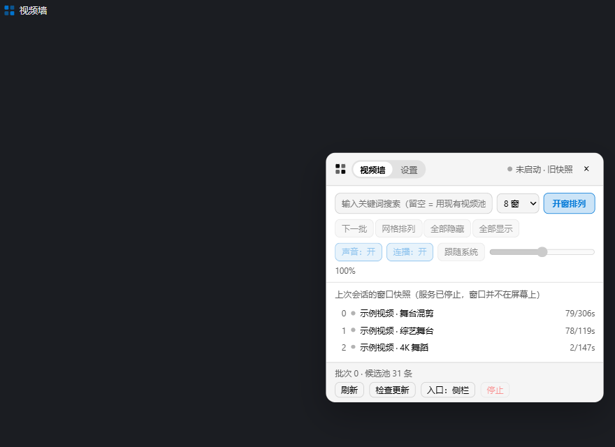
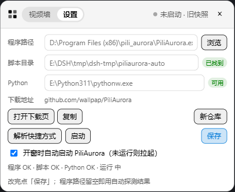

# dsh-piliaurora-wall

PiliAurora 视频墙 —— 在 DSH 侧边栏一键搜索 B 站视频，并行打开 N 个**独立播放窗口**并自动网格排列。
全程只用指令通道（自建 WebSocket 父进程 + Windows 窗口搬运），**不移动鼠标、不截屏、不读 UIA、窗口先建在屏幕外再搬运**。

## 界面

## 功能

| 能力 | 说明 |
| --- | --- |
| 搜索并开窗 | 面板输入关键词（默认「狗兰 舞蹈」）→ 抓 bilibili 视频池 → 开 N 个独立播放窗口 → 自动网格排列（按主屏实际像素计算网格与坐标） |
| 网格数量 | 1~16 窗任选，网格布局自动适配窗数 |
| 一键声音 | 全部窗口有声 / 全部静音（走 PiliAurora 的协议 `mute` 消息） |
| 全部隐藏 / 显示 | 窗口进程继续播放，只是隐藏到任务栏之外 |
| 下一批 | 换成候选池里本批次以外的视频（候选池容量 > 2×窗数时成立；池不足则按顺序轮转复用） |
| 自动连播 | 按抓取到的视频时长（自开窗时刻计时，含冷启动/缓冲）自动换下一个；候选池用尽后按顺序轮转 |
| 入口形态 | 默认「侧栏」按钮（跟随侧边栏显隐）；可切换成 34×34 独立悬浮球 |
| **依赖自检** | 面板状态灯区分「运行中 / 服务未启动 / 缺脚本 / 缺程序」，不再一律显示"未启动" |
| **自动拉起** | 开窗前若 PiliAurora 主程序没在跑，自动拉起（可在设置页关掉）；脚本目录或 Python 缺失时只提示不代装 |
| **设置页** | 面板头部「设置」页签：程序路径 / 服务脚本目录 / Python 路径全部可手填，带「浏览」（接受 .lnk 自动解析）、「解析快捷方式」、「启动」、「保存」 |
| **官方下载地址** | 设置页直接显示 PiliAurora 的 GitHub 地址并给「打开下载页 / 复制 / 新仓库」三个按钮，用户不用再去搜 |
| **检查更新** | 底部「检查更新」四态（检查中 / 有新版 / 已是最新 / 失败），有新版时悬浮球亮红点 |

## 原理（为什么不需要 UI 自动化）

PiliAurora 的播放小窗是**多进程**：每个小窗是 `PiliAurora.exe --piliaurora-player-window` 子进程，
父进程起回环 `WebSocket` 服务器，通过环境变量 `PILIAURORA_WINDOW_ID / _PORT / _TOKEN` 与子进程握手，
握手成功后发一条 `initialization` JSON（内含 `request`、`bounds`、`cacheDirectory` 等），子进程据此加载视频页面。

本插件不带任何 UI 自动化，而是**自己当父进程**：

1. `<脚本目录>\wall_server.py` 启动 N 个播放窗口进程，握手后把 `bounds` 设到屏幕外；
2. 子进程就绪约 2 秒后，用 `user32.MoveWindow / SetWindowPos` 把窗口搬到网格位（延迟 3 秒，避开 Flutter 启动时回写 bounds）；
3. 声音靠协议消息 `{"type":"mute","muted":false}`（必须在 ready 后约 2.5 秒发，早发会被静默丢弃）；
4. 命令通道：写 `wall\cmd.json`，服务回写 `wall\result.json`。

## 使用

1. 侧边栏底部点「视频墙」图标（或切到悬浮球模式后点球）；
2. 输入关键词 → 选窗数 → 「开窗排列」；
3. 面板下方实时显示每个窗口的标题与播放进度；
4. 依赖没配好时点头部「设置」页签：留空即用自动探测结果，填错可「浏览」重选 → 「保存」。

## 依赖与自动探测

| 依赖 | 自动探测顺序（命中即用） | 可在设置页覆盖 |
| --- | --- | --- |
| 服务脚本目录 | 配置 `autoDir` → 环境变量 `PILIAURORA_AUTO_DIR` → `E:\dsh-tmp\piliaurora-auto` → `E:\DSH\tmp\dsh-tmp\piliaurora-auto` → `%USERPROFILE%\.dsh\piliaurora-auto` → 插件包内置 `scripts`（缺脚本时自动释放到 `~\.dsh\piliaurora-auto`） | ✅ |
| PiliAurora | 配置 `exePath` → 5 个常见安装路径 → 桌面/公共桌面 `.lnk` 快捷方式解析 | ✅ |
| Python | 配置 `pythonPath` → 环境变量 `PILIAURORA_PYTHON` → `E:\Python311..313` / `C:\Python311..312` 的 `pythonw.exe` → `python` → `py` | ✅ |

- 判定「脚本目录」的硬条件是**该目录同时存在 `wall_server.py` 与 `fetch_pool.py`**；只有空 `wall\` 数据目录不算命中。
- 配置文件：`%USERPROFILE%\.dsh\piliaurora-wall.config.json`（首次保存时自动创建）。
- 脚本目录必须同时是数据目录（`wall\status.json`、`pool.json` 都写在这里），宿主启动服务时会显式传 `PILIAURORA_AUTO_DIR` / `PILIAURORA_EXE` 环境变量，因此脚本放哪都能把状态写回同一处。

## PiliAurora 官方地址

设置页会直接显示并在需要时用系统浏览器打开（宿主 `POST /open-url`，只放行 `https://github.com`）：

| 用途 | 地址 |
| --- | --- |
| 下载 / 更新（当前在本仓库发布） | https://github.com/wallpap/PiliAurora/releases/latest |
| 后续版本（2.0.2 起本仓库只读归档） | https://github.com/wallpap/PiliAuroraNext |

## 语言

面板文案目前仅中文（硬编码）；`locale/zh-CN.json` 与 `locale/en.json` 的 `meta` 段用于 DSH 插件市场的展示名称与描述，`panel` 段暂未被界面读取。

## 生效方式

| 改动 | 生效方式 |
| --- | --- |
| `lib/index.js` / `package.json` / `cordis.patch.yml` | **彻底退出 DSH 客户端再启动**（宿主是 Node 进程，没有热重载） |
| `lib/client.js` | 面板内 **Ctrl+Shift+R 硬刷新** |
| `scripts/*.py` | 下一次开窗自动生效（每次开窗都会重新起服务进程） |

## 许可

MIT
